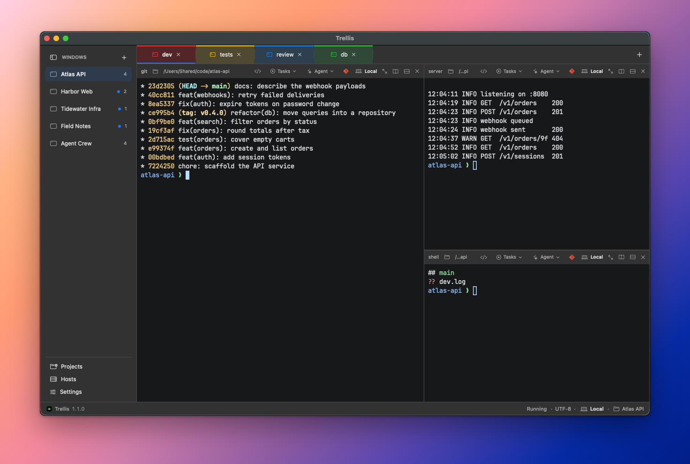
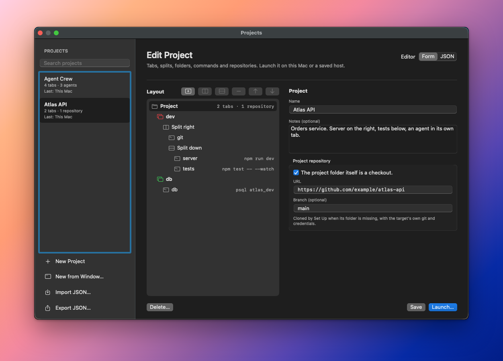
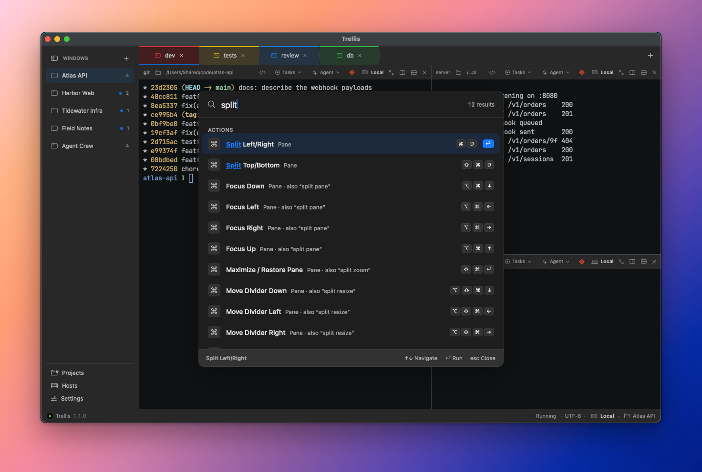
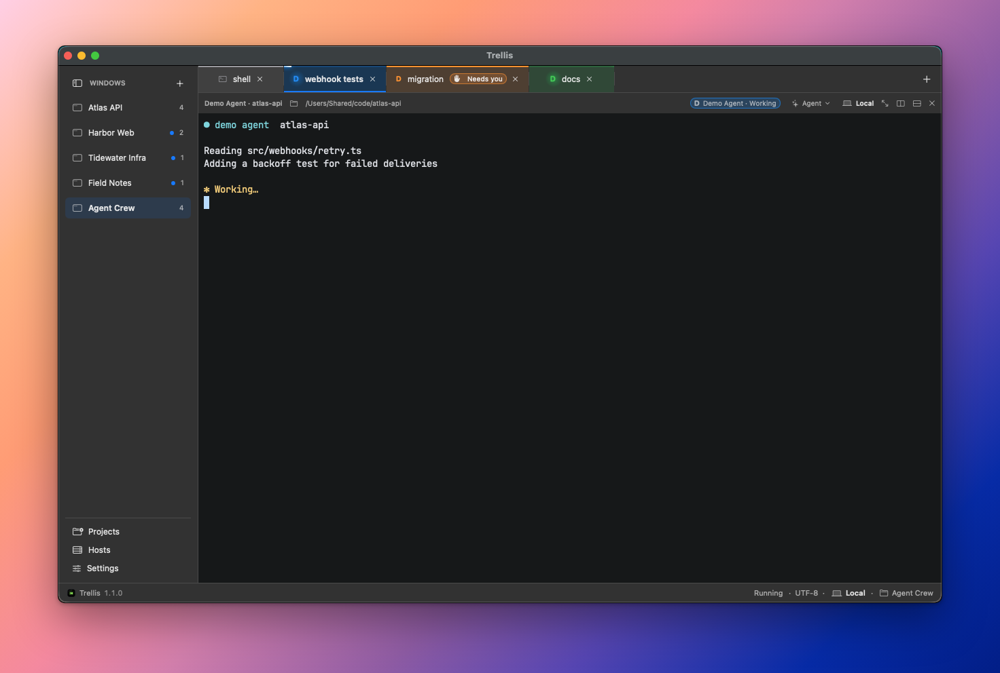

Not using them. Looking for them. My setup was iTerm2 and a growing pile of windows, a few for each project, and every time I needed to act on something I first had to work out where that something lived. Which window had the API server? Which one was the tests? Which of these looked identical panes was the one I wanted to type into?

Then coding agents joined the pile, and it got worse. Several of them would be running across my projects at once, and following their state meant walking from window to window to see who was still working, who had finished and who had been sitting there waiting for an answer. The terminal had become the place where I did all my work and also the thing I understood least about my own setup.

It was driving me a little crazy. I had put up with it for long enough that the interesting question stopped being how to arrange my windows better.

The interesting question was whether I could build the terminal I actually wanted.

## Friday

On Friday, 16 October, I started the day with an idea and no intention of doing more than a prototype. The idea was simple: a native Mac app, fully integrated with CLI agents, where I could easily express how the panels of each project should be split, and move between projects quickly. If the prototype improved my setup, good. If it didn't, I would have lost a day.

The first commit landed at 11:11, and it wasn't code. It was a set of specifications and a backlog of stories, for a product that was called uTerm at the time. The first feature followed twelve minutes later, a small native host to find out whether the whole thing was feasible.

It was. The stories started falling one after another: a workspace model, real terminal sessions, a sidebar of windows, tabs per window, nested splits. By lunchtime I had the shape of the thing. Through the afternoon came restoring workspaces, copy and paste, scrollback and search, and themes. At 17:20 uTerm became Trellis, which is a better name for something whose whole purpose is to hold growing things in place.

The evening went to the part that makes it more than a nicer window manager: saved SSH hosts, a local control API, scoped access for scripts and agents, declarative layouts and a `trellis` command-line tool.

At 22:29 I tagged v0.9.0. Thirty-two stories, 52 commits, one day.

## The weekend

A prototype that works on Friday night tells you very little. What tells you something is living in it.

So that's what I did with the weekend, step by step: use it, notice what got in my way, fix that, and use it again. Saturday brought 39 more commits and Sunday another 31, and you can read my workflow improving in the log. Tabs learned to show when something in them was busy, which was precisely the thing I had been walking between windows to check. Terminal programs could raise desktop notifications, and then Trellis could tell me when a long command had finished. I no longer had to keep looking.

Sunday got more serious. If this was going to hold my entire working day, it had to behave like something that could. I ran a security audit and spent the evening fixing what it found, from unbounded image payloads to paste handling. That same night sessions learned to keep running after the app quit, because losing a running agent to an app restart is exactly the kind of thing that sends you back to your old terminal.

## I stopped opening iTerm2

After that first version I abandoned iTerm2 and moved completely into Trellis.

It's a slightly reckless thing to do with a terminal that didn't exist a few days earlier. But the fastest way to find out what's wrong with a tool is to have no alternative open, and the things that hurt went straight onto the list and usually got fixed the same day.

It's still part of my workday, and I have no plans to go back.

## What a workday looks like now

Trellis keeps moving because I keep using it. Nineteen days after that first commit it has reached v1.1.0, and the days look nothing like the one that started this.

Each project is a window in the sidebar, with its own tabs and splits, so moving between projects is one click and everything is where I left it. The ones I come back to live in a project library that describes tabs, splits, commands, git repositories and agents, and launching one sets up the folder, clones whatever is missing and opens the window.

When I can't remember where something is, ⇧⌘P searches every action, window, tab, pane and host, and ⌘J jumps to a directory I've recently been in.

Then there are the agents, the original itch. An **Agent** button in each pane header opens Claude Code, Codex or pi in that pane's folder, on that pane's machine. The tab shows the agent's icon and its state, which comes from the agent's own hooks and the terminal's signals, not from anything parsing what the agent writes. A light moves along the top of the tab while the agent works. **Needs you** appears when it wants an answer. If that happens while I'm looking at something else, I get a notification.

That took until 1 November to get right, and it's still marked as a preview. But it's the feature that answers the question I started with. I look at the tabs and I know what my agents are doing.

The newest piece is remote workspaces, also a preview. A saved Linux or macOS host opens as a sidebar window like any other, with its sessions held by a small helper on the host. Close the laptop, lose the connection or quit the app, and they keep running. When the link returns, the panes come back on their own.

## How it was built

Trellis is native Swift, with SwiftUI and AppKit for the app and a vendored, lightly patched SwiftTerm as the terminal engine. I built it the same way I now do most things, with coding agents, mostly Claude Code.

## Why it's open

I doubt I'm the only one with this problem. Plenty of developers have spent the last year going from one terminal to a small fleet of them, and I'd guess a lot of them are also hunting through windows.

So Trellis is open source, under the MIT license. It runs on macOS 14 or later, you don't need to create an account, and there's no telemetry. The commit just before that first tag on Friday night reads "prepare 0.9.0 open-source release", so I suppose sharing it was part of the plan earlier than I admitted to myself.

You can [read about it on the product page](https://bearstouch.com/trellis), [download a release](https://github.com/bearstouch/trellis/releases) or [build it from source](https://github.com/bearstouch/trellis#quick-start).

## What's next, and where you come in

This is an evolving project, and the direction hasn't changed: automate more, and integrate with the development tools I actually live in. Several things are already on the [public roadmap](https://github.com/bearstouch/trellis/blob/master/docs/project/roadmap.md), including multiple native windows with tabs that move between them, tmux awareness and a registry for browsing and installing agent definitions.

I have good ideas for the next versions beyond that. The one I keep coming back to is Trellis on the phone: a companion for iPhone and iPad, so that when an agent needs me and I'm away from the desk, I can see what it wants and answer it. Nothing of it is built yet, and it's an idea I'm exploring, not a promise. But anyone who has walked back to their desk to find an agent politely waiting for a yes for the last forty minutes will understand the appeal.

**Contributions are very welcome, and I mean that.** Bug reports, fixes, themes, new agent definitions, documentation and arguments about my decisions are all useful. Documentation matters to me here: the repository [already has a docs folder](https://github.com/bearstouch/trellis/tree/master/docs) that describes how Trellis behaves, and my goal is to have every feature properly documented, so that's also a very good place to start. The [contributing guide](https://github.com/bearstouch/trellis/blob/master/CONTRIBUTING.md) explains how changes get made.

I'm sharing this because it improved my daily routine and it might improve yours, especially if you're a terminal lover like me. Try it, tell me what gets in your way, and if you feel like fixing it, even better. That's how it got this far.
